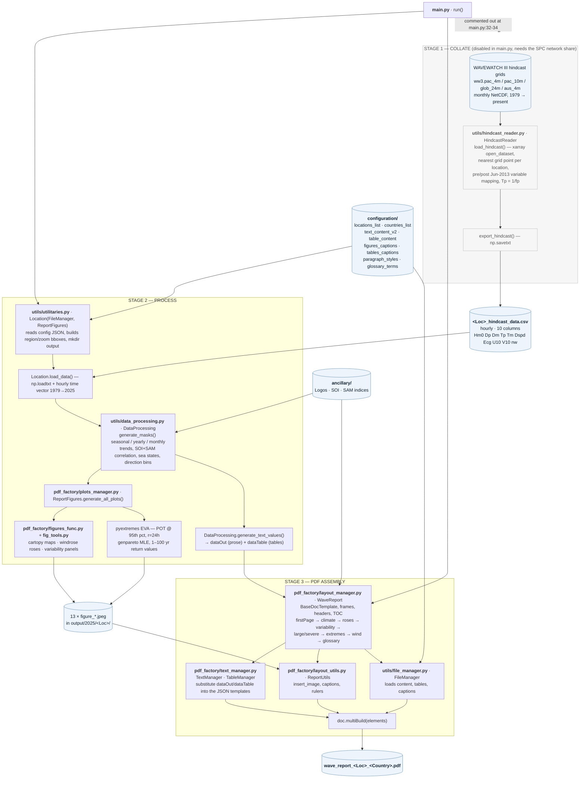

# WaveClimateReport

Generates per-location Pacific wave climate PDF reports from WAVEWATCH III hindcast
data — wave/wind roses, monthly and yearly variability, extreme value analysis, and
sea state occurrence tables, assembled into a single ReportLab document.

## Requirements

- Python 3.12 or newer
- No system libraries needed — GEOS, PROJ, HDF5 and friends all ship inside the
  wheels, so there is nothing to install via Homebrew or conda.

## 1. Create the environment

From the repository's parent directory:

```bash
python3 -m venv vwave
source vwave/bin/activate          # Windows: vwave\Scripts\activate
```

## 2. Install the dependencies

```bash
cd WaveClimateReport
pip install -r requirements.txt
```

This installs 36 packages (numpy, pandas, scipy, xarray, netCDF4, cartopy, geopandas,
matplotlib, windrose, pyextremes, copulas, reportlab and their dependencies) — see
[requirements.txt](requirements.txt) for the pinned versions.

## 3. Run

```bash
python main.py
```

> **Run it from the `WaveAltasReports` directory.** All configuration, ancillary and
> output paths are resolved against the current working directory, so running it from
> anywhere else will fail to find `configuration/`.

A single location takes roughly 15–20 seconds. Expected console output:

```
Working on Betio
Region map was saved
Local map was saved
Annual wave rose was saved
...
Sea States occurences was saved
```

### Choosing which locations to process

Edit the `locList` in [main.py](main.py#L25). The full set of configured locations is:

```python
locList = ['Penrhyn', 'Lakepa Island', 'Rotuma Island', 'Mare Island',
           'Betio', 'Guam', 'Pago Pago', 'Yap']
```

Every name must exist in [configuration/locations_list.json](configuration/locations_list.json).

### Input data

Each location reads a pre-extracted hindcast time series from
`output/<year>/<Location>/<Location>_hindcast_data.csv`. If that file is missing, run
the `HindcastReader` block that is currently commented out at [main.py:32-34](main.py#L32-L34)
— note it reads the raw WW3 NetCDF grids from the SPC network share configured in
[utils/hindcast_reader.py](utils/hindcast_reader.py#L22), so it only works on-network.

The first run also downloads Natural Earth basemap data for cartopy. `main.py` disables
TLS verification for that download ([main.py:13](main.py#L13)) because the network
re-signs the connection.

## 4. Outputs

Everything is written under `output/`, grouped by year and then by location:

```
output/
└── 2025/
    └── Betio/
        ├── Betio_hindcast_data.csv          # input time series
        ├── figure_1_region.jpeg
        ├── figure_1_zoom.jpeg
        ├── figure_2_annual_wave_rose.jpeg
        ├── figure_3_seasonal_wave_rose.jpeg
        ├── figure_4_monthly_wave_variability.jpeg
        ├── figure_5_yearly_wave_variability.jpeg
        ├── figure_6_large_severe_wave_rose.jpeg
        ├── figure_7_monthly_large_wave_variability.jpeg
        ├── figure_8_yearly_large_wave_variability.jpeg
        ├── figure_9_extreme_value_analysis.jpeg
        ├── figure_10_sea_states_occurence.jpeg
        ├── figure_11_annual_wind_rose.jpeg
        ├── figure_12_monthly_wind_variability.jpeg
        └── wave_report_Betio_Kiribati.pdf   # the final report
```

The output year is currently pinned to `2025` at
[utils/utilitaries.py:21](utils/utilitaries.py#L21). The line above it switches back to
the current year — uncomment it if you want new runs to land in a fresh directory
instead of overwriting the 2025 set.

## Pipeline

The run splits into three stages: **collate** the raw hindcast into a per-location CSV
(done once, on-network), **process** that CSV into figures and statistics, then
**assemble** the PDF. Only stages 2 and 3 execute on a normal `python main.py` run.



### Stage-by-stage

| Stage | Entry point | Scripts | Produces |
|---|---|---|---|
| 1 · Collate | `HindcastReader(Locations).load_hindcast()` / `.export_hindcast()` | [utils/hindcast_reader.py](utils/hindcast_reader.py) | `<Loc>_hindcast_data.csv` |
| 2 · Process | `Loc.load_data()` → `Loc.generate_all_plots()` → `Loc.generate_text_values()` | [utils/utilitaries.py](utils/utilitaries.py), [utils/data_processing.py](utils/data_processing.py), [pdf_factory/plots_manager.py](pdf_factory/plots_manager.py), [pdf_factory/figures_func.py](pdf_factory/figures_func.py), [pdf_factory/fig_tools.py](pdf_factory/fig_tools.py) | 13 JPEGs + `dataOut` / `dataTable` dicts |
| 3 · Assemble | `WaveReport(fpath, locName, txt_keyValues, table_keyValues)` | [pdf_factory/layout_manager.py](pdf_factory/layout_manager.py), [pdf_factory/text_manager.py](pdf_factory/text_manager.py), [pdf_factory/layout_utils.py](pdf_factory/layout_utils.py), [utils/file_manager.py](utils/file_manager.py) | the report PDF |

Stage 3 does no computation — it only reads the JPEGs off disk and substitutes the two
dicts from stage 2 into the text and table templates in `configuration/`.

## Layout

| Path | Contents |
|---|---|
| [main.py](main.py) | Entry point — picks locations and drives the pipeline |
| [utils/](utils/) | Data loading, hindcast reading, extreme value analysis (`pyEVA`) |
| [pdf_factory/](pdf_factory/) | Figure generation and ReportLab document assembly |
| [configuration/](configuration/) | Location/country definitions, report text, captions, styles |
| [ancillary/](ancillary/) | Logos and climate index series (SOI, SAM) |
| [output/](output/) | Generated figures and reports |
| [dev_test.py](dev_test.py) | Scratch script for exercising individual components |

## Notes

- Two modules sit outside the pipeline drawn above:
  [pdf_factory/report_content_manager.py](pdf_factory/report_content_manager.py) is only
  reached from `dev_test.py`, and `WavesExtremeValuesAnalysis` in
  [utils/pyEVA.py](utils/pyEVA.py) is imported by `plots_manager.py` but never
  instantiated — the live extreme value analysis runs through `pyextremes`. `pyEVA.py`
  is not fully dead, though: `PhysicalConstants` from it is used by the wave energy
  calculation in [figures_func.py](pdf_factory/figures_func.py#L949-L950).
- There are two separate `FileManager` classes — one in
  [utils/utilitaries.py](utils/utilitaries.py#L18) used by `Location`, one in
  [utils/file_manager.py](utils/file_manager.py#L18) used by `WaveReport`. They overlap
  but the second also loads the table and caption JSON. There is a `TODO` in
  `layout_manager.py` about merging them.
- `dev_test.py` calls `generate_location_map()`, which reads a
  `ancillary/coastline_pacific_countries/Pacific_Coastlines_0_360.shp` shapefile that is
  not in the repository. The `main.py` pipeline does not use it — the maps it produces
  come from cartopy's Natural Earth data instead.
- `environment_noBuilds.yml` and `environment_fromHistory.yml` are the original conda
  environment definitions, kept for reference. `requirements.txt` is the supported path.
